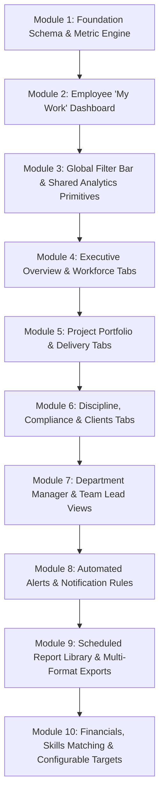

# Workforce Analytics and KPI Blueprint — Step-by-Step Implementation Plan

**Reference Document:** *Workforce Analytics and KPI Blueprint (Oct 27, 2026)*  
**Target Codebase:** `ziel-whispers` (Ziel Log System)  
**Architecture Mandate:** Component-Based Architecture, Single Source of Truth, Pages as Orchestrators (< 300 lines), strict test-driven checkpoints.

---

## 📋 Execution Protocol
1. **Module-by-Module Progression:** We will develop each module sequentially.
2. **Zero Code Changes Ahead of Time:** No implementation of subsequent modules will begin until the current module has been implemented, verified, tested, and explicitly approved by the user.
3. **Component Reusability:** Every UI element will consume existing primitives from `src/components/ui/` and standard utilities from `src/lib/` without inline duplication.
4. **Testing Gate:** Each module concludes with a dedicated verification checklist (schema validation, unit tests, and UI acceptance).

---

## 🏗️ Module Breakdown

---

## 🔹 Module 1: Foundation Schema & Centralized Metric Engine (Data Layer & SSoT)

### Objective
Establish database-level prerequisites, eliminate schema data gaps identified in Blueprint Section 5.3, and create a single, immutable source of truth for all metric calculations in TypeScript.

### Tasks
1. **Database Migration (`supabase/migrations/`)**:
   - Create `holidays` table (`id`, `date`, `name`, `region`, `created_at`).
   - Add reporting hierarchy to `users`: `reports_to` (UUID FK -> `users.id`), `is_department_head` (boolean, default `false`), `left_at` (date), `exit_reason` (text).
   - Add project delivery fields to `projects`: `is_billable` (boolean, default `true`), `billing_type` (`fixed`, `t_and_m`, `retainer`, `internal`), `budget_hours` (numeric), `baseline_end_date` (date).
   - Add resource allocation field to `project_members`: `allocation_percentage` (numeric, default `100`).
   - Add task timestamp: `tasks.started_at` (timestamptz).
   - Add break time config to `system_settings`: `default_break_minutes` (default `60`).
   - Regenerate / update Supabase TypeScript interfaces in `src/integrations/supabase/types.ts`.
2. **Centralized Metric Dictionary (`src/lib/metrics.ts`)**:
   - Implement pure, unit-tested functions for all 23 blueprint formulas:
     - Working days in period (factoring 5/6-day work weeks, `join_date`, and company `holidays`).
     - Shift hours per day (`shift_end - shift_start - break_minutes`).
     - Gross Capacity vs. Leave Hours vs. Net Capacity.
     - Utilization % (`logged_hours / net_capacity`).
     - Billable Utilization % (`billable_logged_hours / net_capacity`).
     - Allocation % & Allocation Gap (`allocation_% - utilization_%`).
     - Attendance Rate, Punctuality Rate, Log Compliance %, On-Time Log Rate.
     - Cycle Time, Lead Time, Estimate Accuracy Ratio, On-Time Delivery %.
     - Project Burn %, Schedule Variance, Blocker Age.
3. **Unit Tests (`src/lib/__tests__/metrics.test.ts`)**:
   - Comprehensive test suite covering boundary conditions (holidays, zero logged hours, half-day leaves, custom shifts).

### Testing & Verification Gate
- [ ] Database migration applies cleanly with zero downtime.
- [ ] Supabase types in `types.ts` include all new fields without compiler errors.
- [ ] 100% test coverage passing for `src/lib/metrics.ts` via `vitest run`.
- [ ] User review and approval before proceeding to Module 2.

---

## 🔹 Module 2: Employee "My Work" Dashboard (Personal View Refactor)

### Objective
Deliver Section 4.1 of the Blueprint by giving every employee a motivating, fast, self-management command center ("My Work") free of surveillance or peer rankings.

### Tasks
1. **Daily Strip Component (`src/components/employee/dashboard/EmployeeDailyStrip.tsx`)**:
   - One-tap clock in/out punch with work mode picker (`onsite`/`remote`), shift start, and grace window timer.
   - Today's logged hours progress vs. shift requirement, with quick-add entry and draft submission button.
   - Daily standup prompt card (pre-filled with yesterday's completed tasks).
   - Auto clock-out acknowledgment banner.
2. **Personal KPI Grid (`src/components/employee/dashboard/PersonalKpiGrid.tsx`)**:
   - *My Utilization %*: Ring chart with target band (75–85%).
   - *Hours Logged vs. Expected*: Progress bar with pace marker.
   - *Attendance & Punctuality*: Present days, late days, arrival trend.
   - *Log Streak*: Current streak & best streak badge.
   - *Tasks Due*: Count linking to due today, due this week, overdue.
   - *On-time Delivery %*: 30-day rolling rate.
   - *Estimate Accuracy*: Gauge centered around 1.0.
   - *Leave Balances*: Visual bars by leave category (Annual, Sick, Casual).
3. **Personal Work Widgets**:
   - `MyTasksKanban.tsx`: Cross-project personal Kanban (Backlog, In Progress, Review/QA, Done).
   - `PersonalTimeBreakdown.tsx`: Donut chart of time by project, bar chart of time by category.
   - `MyProjectsCardGrid.tsx`: Assigned projects, member role, allocation %, health state, and logged hours.
   - `AppraisalSummaryCard.tsx`: Printable 30-day/90-day performance pack.
4. **Page Orchestrator Refactor (`src/pages/Dashboard.tsx`)**:
   - Render `EmployeeDashboard` when `profile.role === 'employee'`.
   - Keep page file under 250 lines by orchestrating subcomponents.

### Testing & Verification Gate
- [ ] Employee logs in and sees only personal data (zero peer rankings).
- [ ] Clock-in/out and draft log quick-add work seamlessly from the daily strip.
- [ ] Metric calculations consume `src/lib/metrics.ts`.
- [ ] Page adheres to the < 300 line orchestrator standard.
- [ ] User review and approval before proceeding to Module 3.

---

## 🔹 Module 3: Global Filter Bar, Saved Views & Shared Analytics Primitives

### Objective
Build the reusable global analytics infrastructure defined in Blueprint Sections 1.2, 1.5, and 6.4 (Data Trust Score, Global Filter Bar, Saved Views, Chart Rules).

### Tasks
1. **Global Filter Bar (`src/components/analytics/GlobalFilterBar.tsx`)**:
   - Preset date ranges (Today, Yesterday, This Week, Last Week, MTD, Last Month, QTD, YTD, 30d, 90d, Custom).
   - Period comparison toggle (vs. previous period / same period last year).
   - Granularity segmented control (Day, Week, Month, Quarter).
   - Searchable multi-select cascading filters (Client $\rightarrow$ Project $\rightarrow$ Phase/Sprint, Department, Role, Employee, Work Mode).
   - URL query parameter synchronization (`useSearchParams`) so dashboard states are shareable.
   - Active filter chips bar with one-click dismiss and "Clear All".
2. **Saved Views System (`src/components/analytics/SavedViewsDropdown.tsx`)**:
   - Store user personal presets and shared organization presets (e.g., *"Engineering Last Quarter"*).
3. **Data Trust Badge (`src/components/analytics/DataTrustBadge.tsx`)**:
   - Computes Log Compliance % for the selected scope/range and displays RAG confidence level ("Data Trust Score: 96% — High Confidence" vs. "Warning: 18% Missing Logs").
4. **Universal Chart Wrapper (`src/components/analytics/AnalyticsChartCard.tsx`)**:
   - Standardized container implementing Blueprint Section 6.4:
     - Question title (e.g., *"Are we spending hours faster than we finish work?"*).
     - Target/reference line overlay.
     - Exact formula on hover tooltip.
     - Click-to-drill-down table drawer/modal.
     - Table view toggle for accessibility.
     - Empty/thin data fallback states.

### Testing & Verification Gate
- [x] Filter changes synchronize cleanly to URL parameters.
- [x] Cascading selections work (changing Client narrows Project options, Project narrows Sprint).
- [x] Saved views can be created, switched, and deleted.
- [x] Data Trust Badge correctly computes confidence and explains missing logs.
- [x] 100% of unit tests pass (35/35 passing).
- [x] Ready for Module 4 (Executive Overview & Workforce Tabs).

---

## 🔹 Module 4: Executive Control Room — Overview & Workforce Analytics Tabs

### Objective
Deliver the first two tabs of the Executive (Admin) Control Room (Blueprint Sections 2.1 and 2.2).

### Tasks
1. **Executive Dashboard Shell (`src/pages/ExecutiveDashboard.tsx`)**:
   - 6-tab navigation header with Global Filter Bar and Data Trust Badge.
2. **Tab 1: Overview (Landing Page)**:
   - 10 Executive KPI cards with delta vs. previous period, sparkline, and RAG target indicators:
     1. Active employees (with joiners/leavers this month)
     2. Company utilization % (target 75–85%)
     3. Billable utilization % (target 65–75%)
     4. Active projects (split by health)
     5. Projects at risk or delayed (<15% of active)
     6. Today's attendance (>90%, WFH shown separately)
     7. Log compliance % (last 7 days >95%)
     8. On-time task delivery % (>85%)
     9. Open blockers (zero older than 3 days)
     10. Bench hours (<5% of capacity)
   - 7 Charts: Utilization trend line, Capacity vs. Demand stacked area, Portfolio Health donut, Hours by Client horizontal bar, Hours by Category treemap, Attendance heatmap, Headcount movement waterfall.
   - 3 Exception Panels: *"Needs attention now"* ranked at-risk list, Pending approvals list, Announcements reach %.
3. **Tab 2: Workforce and Utilization**:
   - Utilization by department (sortable horizontal bar with target line).
   - Utilization distribution histogram (<40, 40–60, 60–80, 80–100, >100).
   - Over & under utilized ranked lists (Top 10 / Bottom 10 with trend and root causes).
   - Allocation vs. actual scatter plot (diagonal reference line).
   - Capacity forecast (4–12 weeks of net capacity against demand).
   - Bench report table (staff with free allocation >30%).
   - Resource concentration heat table (people $\times$ projects).
   - Overtime and burnout watch (>45h/wk for 3+ weeks or weekend logging).
   - Team composition stacked bar, Tenure bands, Work mode mix, Leave liability table.
4. **Nightly Snapshot Engine (`supabase/migrations/`)**:
   - Create `metrics_daily` table and RPC procedure to cache daily utilization, attendance, and project aggregates for sub-second query performance.

### Testing & Verification Gate
- [ ] 10 KPI cards render correct calculations and RAG states.
- [ ] All charts render properly with hover tooltips and table toggles.
- [ ] "Needs attention now" panel correctly surfaces items breaching risk thresholds.
- [ ] Performance test: tab loads in < 1 second using precomputed data.
- [ ] User review and approval before proceeding to Module 5.

---

## 🔹 Module 5: Executive Control Room — Project Portfolio & Delivery & Quality Tabs

### Objective
Deliver Tabs 3 and 4 of the Executive Control Room (Blueprint Sections 2.3 and 2.4).

### Tasks
1. **Tab 3: Project Portfolio**:
   - Master Sortable Portfolio Table: Project name, code, client, PM, status, dates, budget hours, logged hours, burn %, progress %, schedule variance, schedule health, budget health, sentiment, blockers, overdue tasks. Row background colored by health status.
   - Burn vs. Progress scatter/bullet chart (progress % vs. burn % with diagonal ideal line).
   - Budget burn curve (cumulative logged hours vs. planned curve vs. budget ceiling).
   - Timeline view (Gantt with baseline ghost bars showing slippage).
   - Health trend small multiples (health score over time per project).
   - Team sentiment line chart & distribution.
   - Staffing by project stacked bar (allocated FTE vs. logged FTE).
   - Project status updates live feed.
   - Scope creep indicator (tasks created post-midpoint vs. baseline).
2. **Tab 4: Delivery and Quality**:
   - Throughput trend column chart (weekly completions stacked by Feature, Bug, Chore, Research).
   - Cycle time & Lead time box plots (median & 85th percentile).
   - Work in Progress (WIP) by status with WIP limit threshold lines.
   - Cumulative Flow Diagram (CFD) (tasks by status category over time).
   - Estimate accuracy bar chart by department and member.
   - Bug ratio line & reopen rate (backward transitions in `task_status_history`).
   - Rework rate (backward transitions from QA/Code Review).
   - Sprint burndown & carryover rate.
   - Velocity column chart with rolling average.
   - Dependency risk network/table.
   - Goals & OKRs progress bars.

### Testing & Verification Gate
- [ ] Portfolio table sorting, search, and drill-down to project details work.
- [ ] Budget burn curves accurately project budget overrun dates.
- [ ] CFD and WIP charts identify workflow bottlenecks.
- [ ] User review and approval before proceeding to Module 6.

---

## 🔹 Module 6: Executive Control Room — Discipline & Compliance, Clients Tabs, & Drill-Down Map

### Objective
Complete the remaining Executive Tabs (Sections 2.5, 2.6, 2.7, 2.8) and establish the seamless drill-down navigation hierarchy.

### Tasks
1. **Tab 5: Discipline and Compliance**:
   - Attendance trend line with weekday pattern.
   - Punctuality column chart & Repeat Offenders table ($\ge 3$ late days in 30 days).
   - Auto clock-out report table & acknowledgment tracking from `auto_clockout_acks`.
   - Log compliance heat table (people $\times$ days: submitted/late/missed).
   - Missed log register with excuse flags and repeat counts.
   - Late submissions column chart (share of logs submitted post-deadline).
   - Leave patterns calendar heatmap (weekday patterns, weekend proximity).
   - WFH usage bar chart vs. policy limits.
   - Approval turnaround time line chart (hours from submission to review).
   - Timesheet edits table (`attendance.edited_by` & audit log anomalies).
   - Standup adherence line chart.
   - Security events table (failed login clusters from `login_attempts`).
2. **Tab 6: Clients**:
   - Client portfolio table (client, active projects, hours this period, hours to date, health, action items).
   - Client concentration Pareto bar (flags any client $>25\%$ of company hours).
   - Client action items table and aging bar.
   - Portal engagement trend (logins, message views).
   - Profitability table (revenue, cost, margin per client/project).
3. **Drill-Down Navigation & Breadcrumbs (`src/components/analytics/AnalyticsBreadcrumbs.tsx`)**:
   - Standardized navigation path: Company $\rightarrow$ Department $\rightarrow$ Team $\rightarrow$ Person $\rightarrow$ Project $\rightarrow$ Task $\rightarrow$ Log Entry.
   - Preserves filter parameters and active date ranges across navigations.
   - Export any filtered table/chart view to CSV and PDF.

### Testing & Verification Gate
- [ ] Discipline metrics accurately isolate repeat attendance and logging offenders.
- [ ] Client concentration alerts highlight dependency risks.
- [ ] Full drill-down path tested from executive KPI to individual log entry.
- [ ] CSV/PDF exports produce formatted reports.
- [ ] User review and approval before proceeding to Module 7.

---

## 🔹 Module 7: Middle Management Dashboards (Department Manager & Team Lead)

### Objective
Implement the scoped operational management lenses specified in Blueprint Sections 3.1, 3.2, and 3.3.

### Tasks
1. **Department Manager Dashboard (`src/pages/DepartmentDashboard.tsx`)**:
   - Scoped strictly to `users.department === current_user.department` (or reporting tree).
   - 8 KPI cards: Dept Utilization %, Billable Share, Headcount & Free FTE, Attendance & Punctuality vs. Company, Log Compliance %, Leave This Month, Projects Supported, Average Estimate Accuracy.
   - Widgets: Team roster board with inline metric bars, Resource allocation matrix, Weekly capacity planner (next 8 weeks), Skill & role coverage, Category distribution, Leave & WFH calendar, Department people watchlist, Standup digest.
2. **Team Lead Dashboard (`src/pages/TeamLeadDashboard.tsx`)**:
   - Scoped to direct reports (`reports_to = current_user.id`) for "Today & This Week".
   - Widgets:
     - *Today Board*: Cards per person with live clock-in status, work mode, late minutes, standup status, in-progress tasks, blockers, hours logged today.
     - *Team Workload*: Horizontal stacked bar of open estimated hours vs. remaining sprint capacity.
     - *Sprint Burndown*: Remaining hours vs. ideal diagonal with scope added markers.
     - *Kanban Summary*: Task counts with WIP limit warnings.
     - *Blocked & Stuck*: Unresolved blockers and tasks idle $>3$ days.
     - *Due Soon & Overdue*: Tasks due in 3 days or late.
     - *Review Queue*: Tasks waiting in Code Review/QA with waiting time.
     - *Logging Status Strip*: Who has logged yesterday with a **1-click reminder action**.
     - *Collaboration Map*: Pair matrix from `task_collaborators`.
     - *1:1 Prep Card*: Printable 30-day performance pack.
3. **Project Manager Dashboard Integration (`src/components/project/dashboard/ProjectManagerDashboard.tsx`)**:
   - Embed full PM KPI strip and execution widgets inside project views.
   - Quick Status Update composer with auto-filled facts.
   - Client portal preview toggle.

### Testing & Verification Gate
- [ ] Department Managers only see their department's data; Team Leads only see direct reports.
- [ ] 1-click log reminder triggers in-app notification to employee.
- [ ] Today Board updates dynamically as team members clock in and log hours.
- [ ] User review and approval before proceeding to Module 8.

---

## 🔹 Module 8: Automated Alert Rules Engine & Multi-Channel Notifications

### Objective
Implement the 12 automated alert triggers and notification workflows defined in Blueprint Section 5.2.

### Tasks
1. **Alert Rules Database Engine (`supabase/migrations/`)**:
   - Table `system_alerts`: (`id`, `rule_name`, `entity_type`, `entity_id`, `recipient_id`, `severity`, `status`, `snoozed_until`, `created_at`).
   - Scheduled database functions / Edge Functions to evaluate triggers:
     1. *Overutilization*: $>110\%$ for 2 consecutive weeks $\rightarrow$ Employee, Lead, Dept Manager.
     2. *Underutilization*: $<50\%$ for 2 consecutive weeks with no leave $\rightarrow$ Lead, Dept Manager.
     3. *Missing Log*: No submitted log by next morning $\rightarrow$ Employee, then Lead after 2 days.
     4. *Repeated Lateness*: 3 late days in 30 days $\rightarrow$ Employee, Lead.
     5. *Budget Burn*: Burn reaches 75% and 90% $\rightarrow$ PM, Dept Manager, Executive at 90%.
     6. *Schedule Slip*: End date passes or variance $>15$ points $\rightarrow$ PM, Executive.
     7. *Blocker Aging*: Unresolved blocker $>3$ days old $\rightarrow$ Lead, PM.
     8. *Task Idle*: In progress with no log/move for 3 days $\rightarrow$ Assignee, Lead.
     9. *Approval Aging*: Leave/WFH pending $>48$ hours $\rightarrow$ Reviewer, then Admin.
     10. *Client Input Overdue*: `client_action_items` past due $\rightarrow$ PM, Account Owner.
     11. *Capacity Crunch*: Forecast demand exceeds capacity in next 4 weeks $\rightarrow$ Dept Manager, Executive.
     12. *Security*: 5 failed logins for one email in 15 minutes $\rightarrow$ Admin.
2. **Notification Dispatch & UI Console (`src/components/notifications/AlertsCenter.tsx`)**:
   - In-app notification center integration with severity badges (Critical, Warning, Informational).
   - Snooze options (1 day, 3 days, 1 week).
   - Webhook adapter for Slack alerts via `slack_user_id` / channel webhooks.

### Testing & Verification Gate
- [ ] All 12 alert conditions tested with edge-case test data.
- [ ] Alerts correctly route to intended recipient roles only.
- [ ] Snooze functionality suppresses notifications until snooze expiry.
- [ ] User review and approval before proceeding to Module 9.

---

## 🔹 Module 9: Scheduled Report Library & Multi-Format Export Engine

### Objective
Implement the 13 scheduled and on-demand reports from Blueprint Section 5.1 with PDF, CSV, and XLSX export engines.

### Tasks
1. **Report Definition Registry (`src/lib/reports/reportDefinitions.ts`)**:
   - Configure datasets, filters, and layouts for all 13 reports:
     1. Executive weekly brief
     2. Monthly business review
     3. Utilization report
     4. Bench and capacity forecast
     5. Project status report
     6. Project closure report
     7. Timesheet report
     8. Attendance report
     9. Leave report
     10. Compliance exceptions
     11. Sprint review
     12. Individual performance pack
     13. Client summary & Audit report
2. **Export Engine Refactor (`src/lib/exportEngine.ts`)**:
   - Multi-tab XLSX export (using SheetJS / ExcelJS).
   - High-fidelity PDF report generation (branded headers, tables, charts).
   - Streaming CSV export.
3. **Scheduled Delivery Manager (`src/components/reports/ScheduledReportsModal.tsx`)**:
   - Configure automated delivery schedules (Monday 8 AM, Month-end, etc.) via email or Slack.
4. **Reports Page Modernization (`src/pages/Reports.tsx`)**:
   - Refactor the existing 3,300+ line monolith into modular orchestrator (< 300 lines) loading dedicated report components.

### Testing & Verification Gate
- [ ] All 13 reports run on demand with active filters.
- [ ] Exports generate valid, styled PDFs and multi-tab XLSX files without layout breakage.
- [ ] Existing `src/pages/Reports.tsx` reduced below the 300-line orchestrator mandate.
- [ ] User review and approval before proceeding to Module 10.

---

## 🔹 Module 10: Financials, Skills Staffing & Configurable Targets (Optimization)

### Objective
Complete Phase 5 of the Blueprint: financial margins, skill-based staffing matching, configurable RAG targets, and client portal enhancements.

### Tasks
1. **Financial Rates & Profitability**:
   - Schema additions: `users.cost_rate`, `project_members.bill_rate`.
   - Calculate revenue, internal cost, and gross margin per project, client, and department.
   - Quantify financial cost of idle bench capacity.
   - Strict RLS: Financial figures visible only to `admin` / `super_admin`.
2. **Skill-Based Staffing & Bench Matching**:
   - Match free bench employees with open project skill requirements based on `employee_skills.proficiency_level`.
   - Single point of failure alerts (skills only known by one employee).
3. **Configurable KPI Targets (`src/pages/KpiSettings.tsx`)**:
   - Table `kpi_targets`: Customizable red, amber, and green thresholds by company, department, and project (replaces hardcoded numbers).
4. **Client Portal Experience Enhancements**:
   - Curated weekly update feeds masking internal notes.
   - Milestone stepper and deliverable sign-off approvals.
   - `portal_events` tracking for client login and engagement analytics.
5. **Final Comprehensive System Audit**:
   - Accessibility audit (color-independent icons, table toggles on all charts).
   - End-to-end performance audit (< 1s dashboard load times across all screens).
   - Full documentation update in `.docs/`.

### Testing & Verification Gate
- [ ] Financial rates and margin calculations tested for accuracy and strict RLS protection.
- [ ] Skill matching suggests best-fit bench resources for project requirements.
- [ ] KPI targets can be adjusted in settings and dynamically update RAG badges across dashboards.
- [ ] Client portal displays only curated, client-safe metrics.
- [ ] Final sign-off and completion.

---

## 📌 Summary of Development Protocol

| Module | Focus Area | Deliverable Type | Prerequisites |
| :---: | :--- | :--- | :---: |
| **1** | Foundation Schema & Metric Engine | Migration + TypeScript Engine + Unit Tests | Blueprint Section 1.4 & 5.3 |
| **2** | Employee "My Work" Dashboard | Components + Refactored Dashboard | Module 1 |
| **3** | Global Filter Bar & Analytics Infrastructure | Shared UI Components + Saved Views | Module 1 |
| **4** | Executive Overview & Workforce Tabs | Executive Dashboard Shell + Tabs 1 & 2 + Precomputation | Modules 1, 3 |
| **5** | Project Portfolio & Delivery & Quality Tabs | Executive Tabs 3 & 4 | Modules 1, 3, 4 |
| **6** | Discipline, Compliance, Clients & Drill-Downs | Executive Tabs 5 & 6 + Drill-Down Map | Modules 1, 3, 5 |
| **7** | Department Manager & Team Lead Dashboards | Role-Scoped Operational Views | Modules 1, 2, 3 |
| **8** | Automated Alert Rules & Notification Engine | Background Triggers + Notification Console | Modules 1, 7 |
| **9** | Scheduled Report Library & Export Engine | Report Registry + PDF/XLSX Exporters | Modules 1, 3, 4, 5, 6 |
| **10** | Financials, Skills Staffing & Configurable Targets | Financial Engine + Skills Matcher + Settings | All prior modules |

> **Next Step:** We will wait for your confirmation before touching any code or database schema. Once you are ready, we will begin strictly with **Module 1**.
